# Sprout action flows

Current journey contracts, updated October 3, 2026. These describe required behavior, not an implemented application. See [product direction](product-direction.md), [architecture](architecture.md), [open decisions](open-decisions.md) and [source corpus](source-validation-corpus.md).

Core, Later and Advanced label delivery scope. Nodes marked Decision needed name unresolved policy; arrows through them describe required outcomes, not a selected policy. Cross-journey labels name the destination step. Each section's rules complete its compact map; no diagram claims to enumerate all possible real-world inputs.

Maintainer: edit `workflow-data.json`, then use `scripts/build-workflows.py` to rebuild this document and the diagram together. See [builder instructions](../scripts/README.md).

## 00 · The whole product

Core → later → advanced

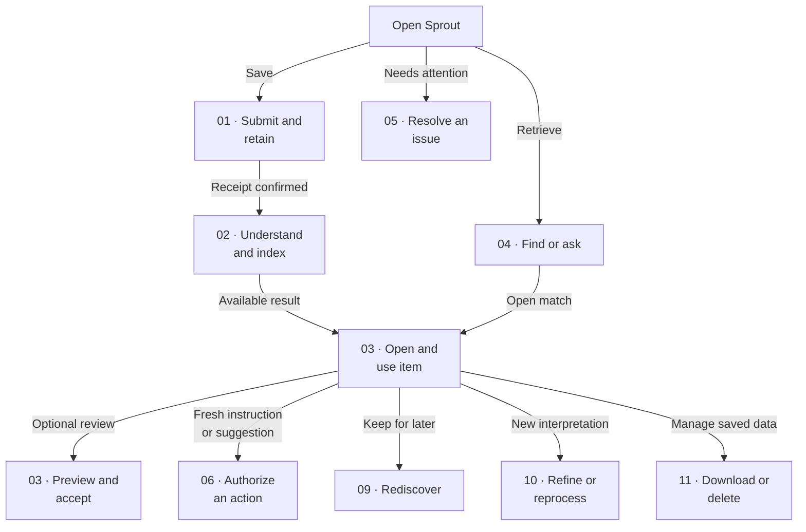

### Behavior contract

- Home opens with search and recent items, a visible Needs your input count, and Add for text, a pasted link or a file. Card and compact list views remain in scope.
- The visual library uses sidebar navigation, recognizable saved-item cards, compact list views and an inspector. Spaces preserve owner-chosen membership, arrangement, grouping and filters without forking originals or understanding.
- Open/use is the central junction. New items can be searched, read and downloaded. Acceptance records review of the displayed understanding; it does not certify truth or authorize actions.
- One submission creates one item, except deliberate exact-content reuse. Its subjects remain individually discoverable. The owner will add the existing backlog in normal batches.
- Core means useful capture, understanding, retrieval, original access, processing visibility and recovery for text, images, video, links, Instagram, X and YouTube. A text-only checkpoint is not completion of core.
- Windows self-hosting and installed Galaxy sharing are selected, with a named Cloudflare Tunnel and application authentication. Validate the actual route; access depends on the host being running and reachable. Cloud AI is acceptable.
- Later stages add tasks, reminders, Sprout/linked Google calendars and resurfacing. Comments, refinement, reprocessing, versions and rollback remain advanced. This map does not implement those features.

## 01 · Capture and preserve

Core · source/device support unverified

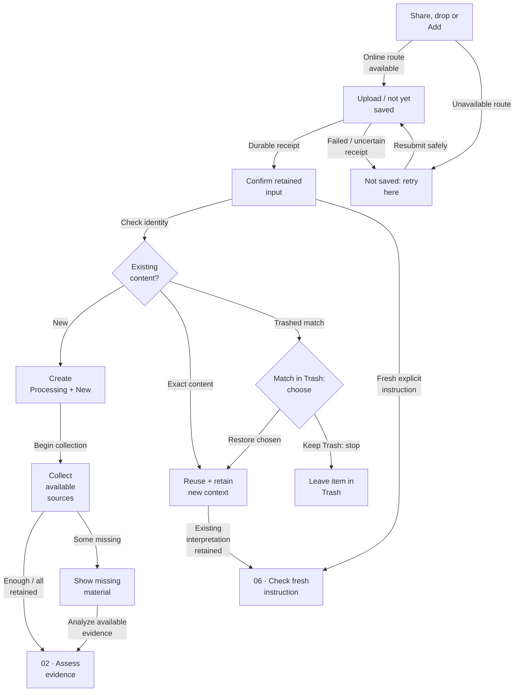

### Behavior contract

- On Galaxy the intended route is an installed web share target, subject to real testing. On Windows support dragging links/photos/videos and direct text, paste or upload. If sharing is unavailable, offer direct input. WhatsApp-origin content is supported through ordinary input; a bot or direct integration is not promised.
- Before acknowledgement the capture surface says uploading/not saved. Only a durable receipt permits a saved claim, and only for the text and attachment bytes actually retained. Missing attachments are individually named. Pre-receipt failure stays recoverable in the submitting surface.
- A lost acknowledgement is resolved against the same logical submission before retry. Safe full resubmission is sufficient; persistent offline capture and resumable uploads are not implied.
- A transport retry is the same submission; a later deliberate save has its own new intent. Exact duplicate reuse preserves that intent, new files and collection choices without altering the first Original input or automatically rewriting the summary. Newly added context is separately searchable.
- The same URL is not proof of identical content. Never discard a new attachment or infer a fuzzy merge. A Trash match requires an explicit restore choice and shows its consequences. Keeping it in Trash ends that duplicate save with an honest result.
- Track received payload, retained bytes, acquired context, analyzed modalities and useful understanding separately. An available URL/thumbnail/transcript does not prove downloaded or analyzed footage.
- Collect directly related links, available media, metadata and available top source comments (up to 20 platform-ranked comments). Do not claim unavailable comments were collected. Preserve timestamps and provenance.
- Every fresh owner instruction, from a new or reused item, goes to 06 · Check fresh instruction. During core, retain the instruction and display Not scheduled; feature launch never replays it.
- Source limitations and file-supply workarounds require observed tests and explicit per-source acceptance before they satisfy the full core milestone.

## 02 · Understand and enrich

Core

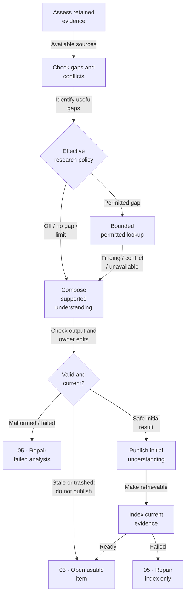

### Behavior contract

- Assess text, images, audio, footage and other source context only when actually obtained and analyzed. Describe absent modalities and any consequent limits. Silent visual instructions must not be guessed from a caption.
- Check contradictions among ALL evidence before composition, including owner input, source captions, audio and comments even when research is Off. Owner corrections take precedence, then captured sources, then external findings; keep relevant competing claims and dates inspectable.
- Global and per-item Off / Fill missing information / Deep research determine effective policy before each lookup. Fill is the default. Deep remains useful-gap-directed and bounded by time, cost and source limits; it is not permission for unrestricted browsing.
- Off material cannot leak through mixed-item lookups. A separable permitted lookup can continue using only permitted material. Minimize outbound context; do not send ticket codes or private message bodies to find public venue facts. These controls must exist outside the AI prompt.
- AI understanding combines the original input and acquired evidence into a useful summary, category, saving intent and flexible enriched facts. Associate each fact with its correct subject and support. Do not impose a category-specific schema.
- Distinguish owner-stated saving intent from inferred intent. Stop external research when the useful gap is filled or another lookup adds little value; unknown fields remain unknown.
- Invalid AI output, failed media analysis and quota exhaustion are recoverable states, not successful understanding. Existing originals and completed useful output remain accessible when optional AI work is paused.
- Publish only against the current item state. Concurrent owner corrections win; deleted items cannot be republished by delayed work. Index repair uses current stored material and never calls enrichment.
- Initial processing may expose a labeled interim result. Once an understanding is committed, new evidence is retained separately and does not silently replace it. The exact initial commit boundary must be specified before implementing resume behavior.

### Still to decide

- Initial interim-versus-committed boundary and precise mandatory common properties are still implementation design decisions.

## 03 · Inspect, correct and accept

Core

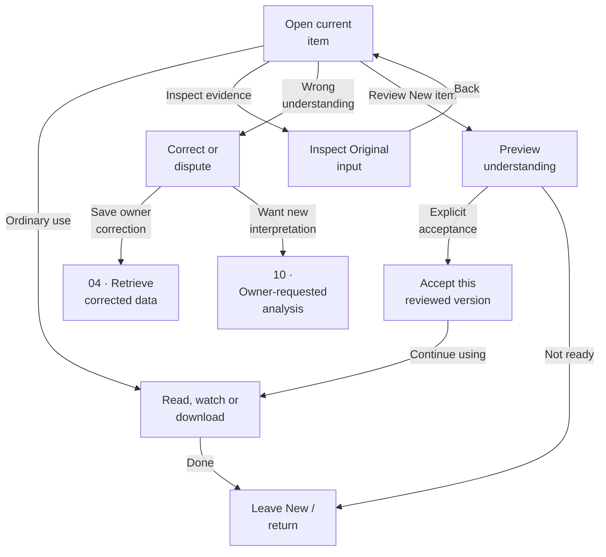

### Behavior contract

- Lead with understood data when available; otherwise show original input and progress honestly. Original input remains a separate button with submitted text, links and attachments. Retained files open independently of the live source.
- New does not block exact/AI search, opening, source access or download. New/accepted markers remain visible. Opening an already accepted item does not create another acceptance chore.
- Acceptance refers to the understanding the owner actually previewed. If that displayed revision changed, require a current preview before accepting. Acceptance acknowledges review, not factual certification or action permission.
- Core manual correction includes title, category, saving intent, summary text and individual flexible facts. The owner may remove or dispute unsupported understanding and keep the original. Exclude disputed generated claims from answers and distinguish owner corrections from source statements.
- Corrected material is re-indexed; originals stay intact and later processing cannot overwrite owner corrections. Ordinary owner edits do not reset acceptance. Full diff/history/comments are not required for this editor.
- An owner-requested fresh interpretation belongs to the advanced reprocessing flow. While that stage is unavailable, offer direct correction or original-only use, not a Retry button that silently regenerates the completed summary.
- Future material replacement by AI requires explicit review. Raw-only acceptance remains undecided; the owner can always use the retained original without a fabricated summary.

### Still to decide

- Whether a raw-only item can be Accepted without any AI understanding.

## 04 · Find and ask

Core

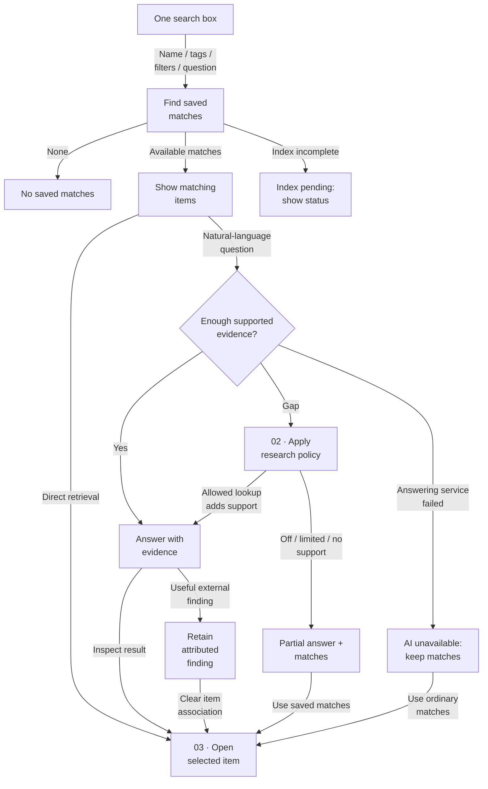

### Behavior contract

- Exact names, tags, filters and natural-language questions share an entry point. Ordinary matches remain useful without an AI answer. Display New markers and current processing/index status.
- Distinguish no matches, matches with missing information, supported answers, index not yet ready, and AI/service errors. Do not turn missing restaurant hours into No restaurants found. Do not invent a saved match from web results.
- Answers identify supporting items and relevant source evidence, dates, uncertainty and disagreements. Facts stay attached to the correct subject; a multi-restaurant video is one item whose restaurants can each be found.
- External gap filling obeys the same effective policy as capture. Off material stays out of outbound mixed-item requests. If permitted lookup fails or reaches its bound, return the supported partial answer and matching items.
- Retain useful external findings as separately attributed supporting evidence when their associated item is clear. If association is ambiguous, ask which item; without a choice leave the finding in the query outcome, not silently attached everywhere.
- Retaining a finding does not replace current understanding, accept an item or authorize an action. Advanced Refine may later incorporate it explicitly. Original and external accounts of a past visit remain distinguishable.
- Manual corrections and Trash changes must reach retrieval. Stale/disputed/trashed understanding is not valid answer evidence. Index failure offers 05 · Repair index only; AI failure retains ordinary retrieval.

## 05 · Needs your input and recovery

Core · action recovery later

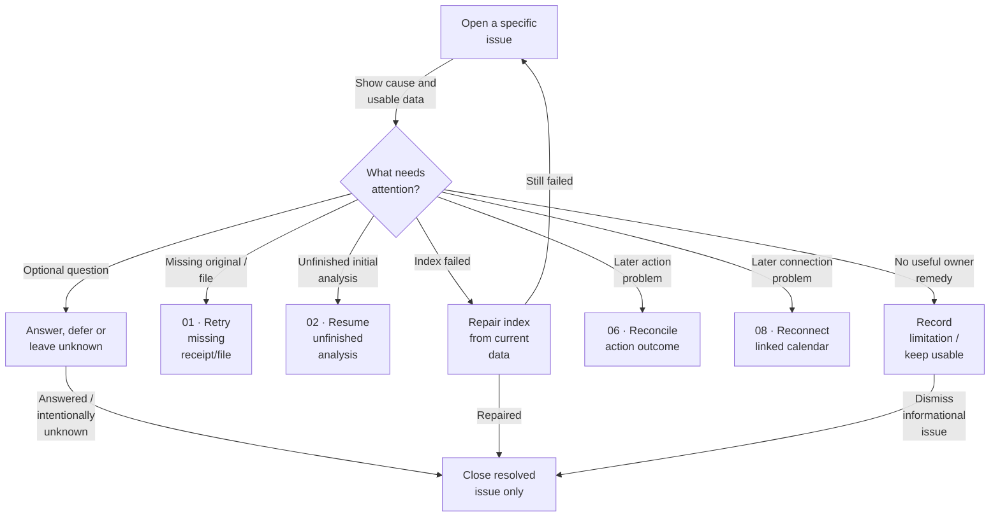

### Behavior contract

- Needs your input is a set of issues, not an item's single status. Separate required repairs, optional clarification and later suggested actions. Each names its affected result, what remains usable, and an exact remedy.
- Deduplicate repeated reports of the same issue. Resolving one issue clears only that issue; it does not accept the item or clear unrelated questions. Close obsolete questions when circumstances change.
- Optional saving intent can remain unknown. Deferring or leaving unknown does not block search. An irreparable source limitation is informational instead of an endlessly repeated request.
- No durable item yet means recovery in the original submitting surface. A retained item with a missing file can have an issue linking to file supply. Do not send an unsaved submission to an empty queue.
- Retry only the failed step: upload/fetch, unfinished initial analysis, index repair, or a later integration repair. A new analysis of committed understanding is advanced owner-requested Reprocessing.
- Newly supplied evidence is retained. Before initial completion it may resume unfinished analysis; after completion it cannot silently overwrite current understanding. Repair-index reads stored current evidence only.
- A failed or uncertain external action goes to its operation outcome, not to a generic execute-again loop. Reconnection does not replay old requests. Failed retries remain visible with bounded retry behavior.
- Late results check current corrections, deletion and cancellation before publication. Diagnostics should identify the failed stage without exposing private source content or secrets.

## 06 · Authorize and execute

Later · core retains instructions only

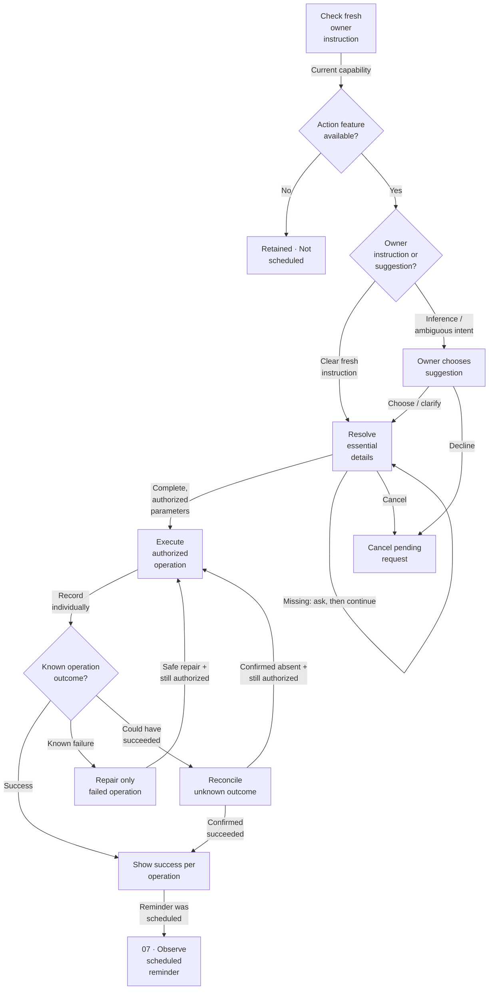

### Behavior contract

- Current owner instructions are distinct from quoted messages, forwarded text, source comments and retrieved imperatives. Source content can support a useful suggestion but can never authorize execution.
- A fresh clear instruction with complete required details executes without another generic permission step. Inferred actions require a choice. Ask only for missing or ambiguous essentials.
- During core, retain requested action text and explicitly state Not scheduled. Acceptance, reshare, transport retry, reconnect and later feature availability never replay old instructions.
- Track each requested operation separately. Event creation may succeed while reminder scheduling fails; repair only unfinished work. Success opens the existing result rather than creating it again.
- External timeout is Outcome unknown when success is possible. Reconcile first using existing operation identity. If uncertainty cannot be resolved, show it and allow a deliberate owner decision to retry with the known duplicate risk, keep waiting or abandon; no blind automatic retry.
- Authorization applies to the intended parameters and current request. Essential changes require the owner to choose the changed action. A cancelled pending request must not execute later; if execution already happened, report the actual outcome and offer a separate disposition.
- Supported later actions include tasks, reminders, Sprout events and linked Google events. Phone notifications and Gmail reminders are for the owner only. No unrelated Google event import or sending to other people.
- Exact handoffs: create event through 08 · Create Sprout event; define reminder timing through 07 · Choose timing before scheduling; after scheduling enter 07 · Observe schedule, not the creation step again.

## 07 · Reminders, snooze and tasks

Later · detailed time policy still to review

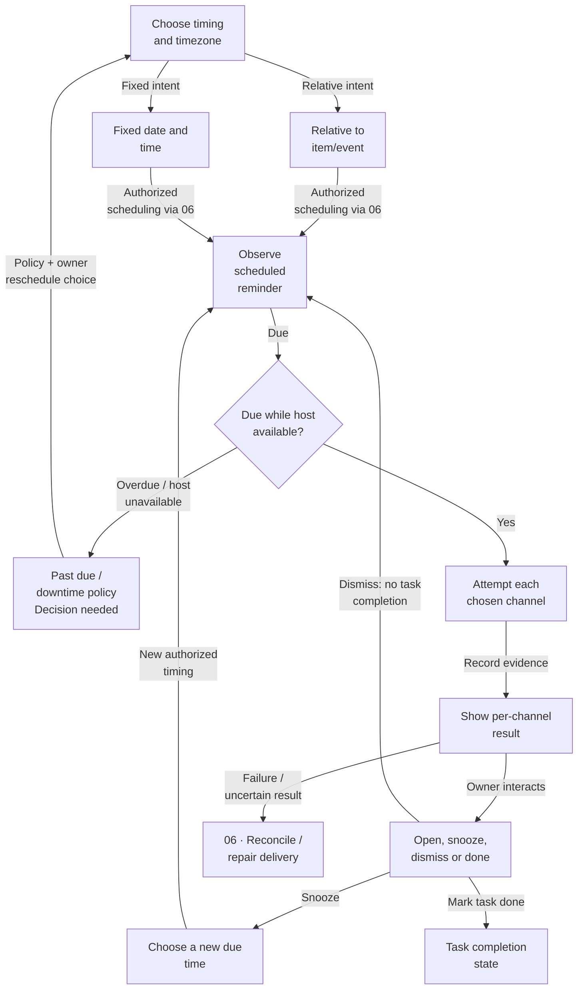

### Behavior contract

- Show the interpreted due instant and timezone before treating timing as known. Event time and reminder time are separate. Missing timing asks unless an owner-configured default applies.
- An undated item may have a fixed reminder without inventing an event. Only explicit completion marks a task done; keep an outstanding-tasks view.
- Relative reminders follow the accepted event/item time; fixed reminders keep their due instant. Movement into the past requires a reschedule decision rather than silent immediate delivery. All-day events and daylight-saving behavior need a coherent later policy.
- Scheduled does not mean delivered. Track each channel's attempt, provider acceptance, known failure and observed owner interaction when available. Provider acceptance is not proof the owner received or read it.
- Phone notifications open the relevant saved item. Self-email is an optional parallel channel. Permission denial, offline devices, locked screen and host restart need actual tests. Delivery failure leaves due/overdue state visible.
- Snooze, dismiss and task completion are different. Dismiss closes that notification and does not complete a task or automatically schedule another occurrence. The schedule view retains its historical dismissed outcome.
- Pending cancellation must be checked before dispatch. Task completion racing a queued notification must have a defined suppression rule. Unknown external outcomes use 06 · Reconcile unknown outcome.
- Candidate later defaults, not yet final: one-time snooze override, completion suppresses remaining task reminders, reopening does not replay old alerts. No new recurrence or quiet-hour requirement is introduced.

### Still to decide

- Choose host-downtime catch-up, all-day/DST behavior, snooze after event movement, completion/reopening policy and notification evidence before this stage ships.

## 08 · Sprout and Google Calendar

Later · Sprout events only

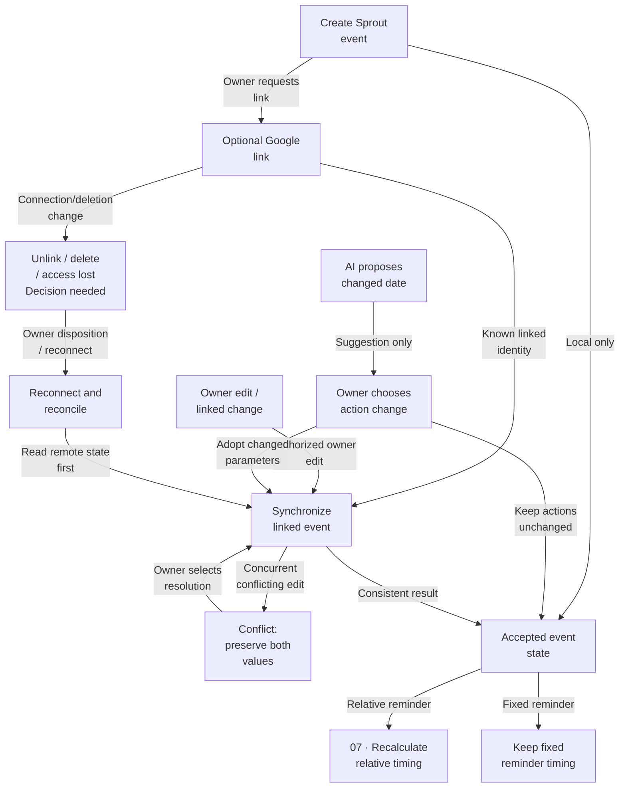

### Behavior contract

- Represent one Sprout event with an optional corresponding Google Calendar link. Only Sprout events/reminders and deliberately linked events are in scope; unrelated Google events stay untouched.
- Owner edits and synchronized owner changes differ from AI findings about a source date. An AI-proposed update needs the owner's choice before it changes an event or reminder.
- Track the linked identity and the versions being reconciled. Avoid echo updates, stale overwrites and duplicate creation. Simultaneous material edits preserve both values for owner resolution.
- Only an accepted event state drives relative reminder recalculation. Fixed reminders do not move. If recalculation puts a reminder in the past, use 07 · Choose timing rather than silently dispatching.
- Revoked access and failed synchronization remain visible. Reconnect reads both sides and reconciles; it does not recreate an event deleted remotely or replay old creation requests.
- Unlink, local deletion, remote deletion and item deletion require an explicit disposition policy. Failed cancellation/deletion stays visible even if the saved item is in Trash.
- Restoring a saved item or previous understanding never revives a cancelled event or commitment. Unknown create/update outcomes use 06 · Reconcile unknown outcome.

### Still to decide

- Finalize unlink/delete behavior on each side and conflict resolution choices before calendar implementation.

## 09 · Resurface and rediscover

Later

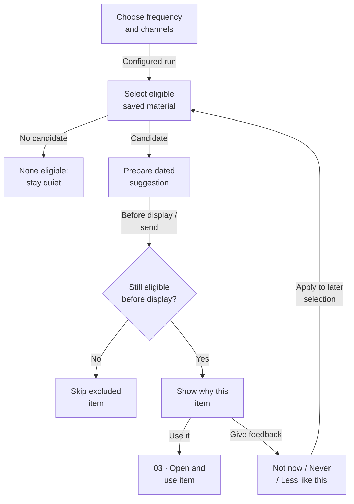

### Behavior contract

- Default to weekly in-app rediscovery, with configurable frequency, categories, collections and optional phone/email channels. Resurfacing is distinct from an explicitly scheduled reminder.
- Let the owner favor forgotten material or actionable ideas, and exclude whole collections. Choosing an activity follows ordinary action authorization; a suggestion is never automatically scheduled.
- Check item visibility, exclusions, feedback and the chosen New/accepted eligibility policy before selection and again before display or dispatch. Trash and excluded items cannot escape via a stale queue.
- No eligible item is a valid result. Do not invent filler or repeatedly recommend an ineligible item to meet a weekly quota.
- Explain why a saved item returned. Distinguish a dated memory from a currently available activity. An expired ticket can be a memory but must not appear as an upcoming show.
- Any permitted freshness lookup follows research settings and cannot silently reprocess the item. Without fresh evidence do not claim current opening hours, prices or availability.
- Not now, Never show again and Less like this have distinct meanings; feedback changes recommendations without deleting saved material. Precise cooldowns and suppression scope remain later choices.

### Still to decide

- New-item eligibility, Not now duration, Less like this scope and reversal of suppression are to be settled before resurfacing ships.

## 10 · Comments, refinement and versions

Advanced

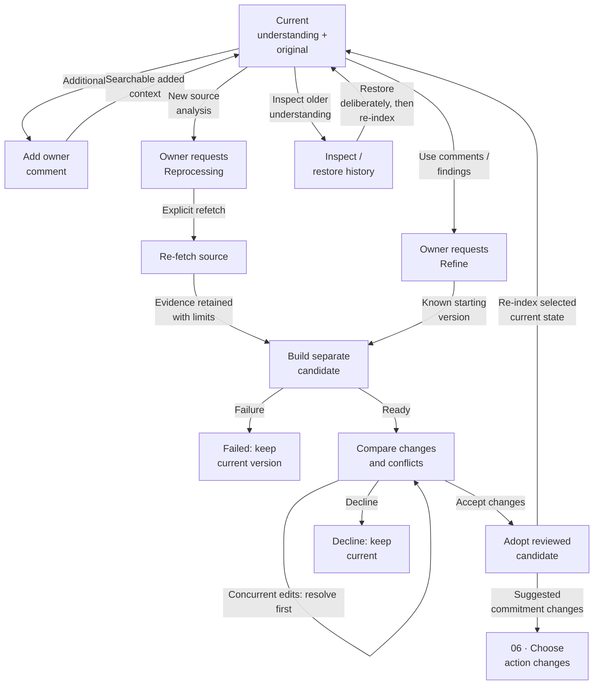

### Behavior contract

- Owner comments add information without manually editing the item and are distinguishable from source comments, external findings and action results. They remain searchable additional context; they do not silently rewrite the current summary.
- A fresh explicit request in an owner-written comment follows 06 · Check fresh instruction. Quotes inside comments remain evidence; adding, editing or restoring a comment cannot replay an old action.
- Refine uses comments and retained findings to propose a change. Reprocessing is always owner-initiated and re-fetches source material. Neither runs automatically because a source or policy changed.
- Preserve original input, first enrichment and later versions. Keep candidate understanding separate from the current searchable account and its evidence.
- Compare the candidate with the starting revision and current state. If owner corrections/comments changed while work ran, show the conflict before adoption; do not overwrite them.
- Failure, unavailable refetch or declining a candidate leaves the current understanding and retained media intact. Partial source access must remain visible in the comparison.
- Adoption is deliberate after a diff/review. Material AI replacement requires explicit review. History restoration changes the selected understanding and repairs retrieval, without replaying instructions, cancelling newer commitments or undoing external work.
- Any recommended action changes are separate suggestions routed through 06 · Check fresh instruction. The owner chooses their disposition; rollback is not action rollback.

### Still to decide

- Choose comment deletion/retention behavior, current-versus-historical search, and exact version-review interaction during advanced planning.

## 11 · Downloads, Trash and commitments

Core · commitment disposition later

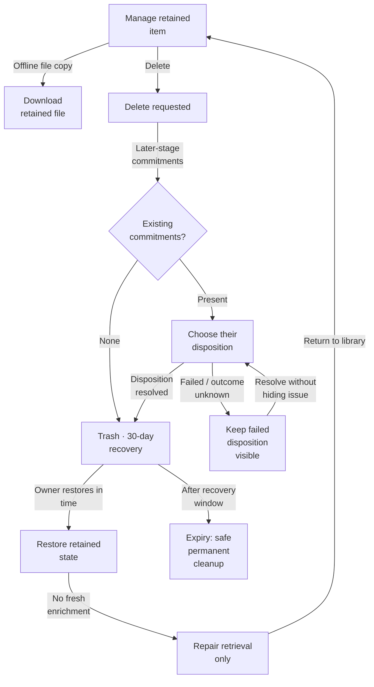

### Behavior contract

- Retain original input and captured media until deletion. Explicit download creates a device copy that can open offline; automatic offline availability inside Sprout is deferred.
- Trash is excluded from ordinary search, AI answers and resurfacing. A dedicated view shows deleted items and expiry. A late processing job cannot return one to the live library.
- Deletion during later action stages shows linked reminders/events and requires owner disposition. Unknown or failed cancellation remains visible; deletion must not make an unresolved commitment disappear.
- Restore retained data and repair its index, without enrichment or instruction replay. Cancelled reminders and events remain cancelled.
- Permanent cleanup after 30 days must tolerate interruption and protect retained media referenced by another item. A duplicate detected in Trash follows 01 · Match in Trash: choose; it is not silently restored.
- Thirty-day Trash is distinct from backup retention and downloaded device copies. Define a manual full records-plus-media backup and verify clean restore before Sprout becomes the sole copy. Backup retention remains an operating decision.
- Keeping an unresolved deletion visible does not require keeping its material in ordinary search; the exact later commitment-disposition presentation must make the remaining obligation clear.

## 12 · Independent states and operating limits

Core · conceptual dimensions, not screens

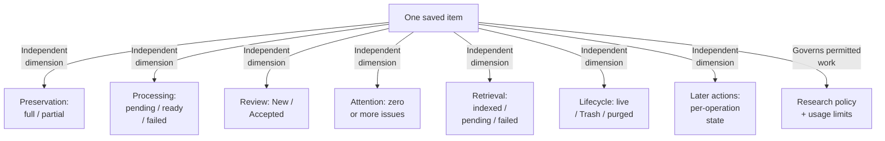

### Behavior contract

- These are independent concepts, not final database enums or a sequence of UI screens. A New item can be searchable and partially preserved, with a usable summary and one open issue.
- Durable receipt precedes saved status. Processing, source fidelity, index readiness, owner review and action results cannot substitute for each other.
- Validate the selected Cloudflare named Tunnel, application session and Galaxy sharing path before real sensitive use. A stopped/unreachable Windows host means unavailable service, not a false receipt or a promised offline queue.
- Keep provider credentials out of client content and logs. Treat URLs, redirects, retrieved instructions and files as untrusted; constrain fetch destinations, file handling and rendered content.
- Choose measured limits for media size/duration, research work, concurrency and storage. Measure complete jobs, including retries and media analysis. Paused optional AI does not prevent reading retained material.
- English UI and generated output; preserve original Unicode text and names. Actual supported source languages and cross-language search must be selected and tested before promising them.
- Future hosting target remains $25–40/month with a $50 pre-tax planning ceiling. This is not a provider selection, spending authorization or exact cross-provider billing guarantee.
- Core operating proof includes authenticated private ownership, two-user isolation tests, honest host-unavailable behavior, safe recovery, faithful originals and a tested manual backup/restore. Public signup and hosted deployment remain later work.
- Every save, correction, search, answer, file, setting, export and processing operation preserves authenticated user ownership. A Space is organization within a private library, not a shared-access tenant.

### Still to decide

- Source-language scope, mandatory common fields, initial commit boundary, original-only review, research acquisition/cloud-analysis interpretation and measured processing limits remain core design/validation work. The stack, authentication-first approach and named tunnel direction are selected.
