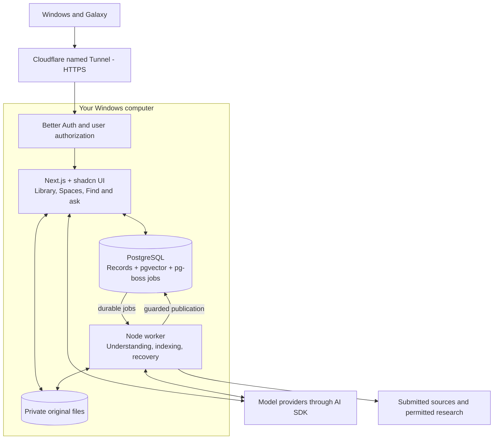

# Sprout architecture

Approved October 3, 2026: modular TypeScript/Next.js application, shadcn/ui + Tailwind + Motion, PostgreSQL + Drizzle + pgvector, separate pg-boss Node worker, Better Auth from the first release, local originals behind a storage contract, and AI SDK with direct provider adapters. Run on the owner's Windows computer first. Cloudflare named Tunnel is the selected access design, pending actual installation and Galaxy validation. The architecture is agreed; integrations are not implemented or proven.

Arrows show major application/data dependencies, not every network connection. Each web entry point and worker publication enforces user ownership; authentication is not merely a page-level gate. The queue is in PostgreSQL, not an additional service. Web and worker invoke the same module contracts; worker publication uses the library's revision/lifecycle guard. AI SDK serves both interactive questions and background understanding. Files remain usable without AI. Optional permitted lookup for questions uses the same policy-controlled understanding operations; it need not wait for the background queue. HTTPS traffic passes through Cloudflare; this is an authenticated Internet-facing hostname, not a private mesh network.

## Validation against the connected flows

Reviewed [connected flows HTML](../outputs/sprout-connected-flows-standalone.html), its chapter rules and SVGs, and [structured source](workflow-data.json). On October 3, `python -X utf8 scripts/check-workflows.py` passed: 13 journeys, 143 nodes, 172 logical connections, valid unique IDs/markers, and generated-source alignment. The browser also loaded all 13 chapters and SVGs. This validates documentation consistency, not a running application. The standalone page includes encoding and theme definitions; the original HTML fragment is intended for embedding.

| Connected journey | Architecture responsibility and invariant |
|---|---|
| 00 Whole product | Authenticated visual library is the home; capture, inspection and retrieval share domain contracts |
| 01 Capture and preserve | Web/library verifies retained files, commits receipt and job together, distinguishes retries from deliberate duplicate saves and preserves new context |
| 02 Understand and enrich | Worker gathers only actually available material; policy checks precede research; validated publication cannot overwrite corrections or revive Trash |
| 03 Inspect, correct and accept | Web/library preserves originals and corrections; New remains usable; acceptance acknowledges the previewed understanding, never action authority |
| 04 Find and ask | Retrieval combines exact/current fields and semantic projections; AI SDK streams grounded answers; AI failure retains ordinary matches; Off material cannot enter outbound mixed queries |
| 05 Needs your input | Library stores specific issues; worker retries only failed stages; index repair never invokes enrichment |
| 06 Authorize and execute | Core retains requested instructions as Not scheduled; future action module owns explicit authorization and operation reconciliation |
| 07 Reminders and tasks | Later module can use durable worker execution; due time, delivery, snooze and completion stay distinct |
| 08 Calendar | Later integration module owns linked identities and reconciliation; reconnect/restore must not replay operations |
| 09 Rediscovery | Later module selects eligible visible items and rechecks exclusions before display/dispatch; research policy still applies |
| 10 Refinement and versions | Advanced module stores candidates separately and adopts only after deliberate review; restoration does not replay actions |
| 11 Downloads and Trash | Web serves authorized originals; library hides Trash immediately; worker handles restartable purge/index repair; coordinated records-plus-files backups preserve recovery |
| 12 Independent states and limits | Domain records keep preservation, processing, review, issues, indexing and lifecycle separate; user-scoped budgets and honest host-unavailable behavior apply throughout |

The journey rules include visual Space organization and authenticated private ownership. The compact graphs emphasize lifecycle handoffs; their rule panels complete the behavior contract. Later/advanced journeys map to extension seams rather than core executors.

## Modules and parallel development

Use one TypeScript workspace with separately runnable web and worker entry points. Next.js owns request/UI composition, not domain rules. The worker executes bounded jobs through the same public domain operations.

| Boundary | Write ownership and public responsibility |
|---|---|
| Saved item library | Durable intake, receipt identity, originals, corrections, review, issues, Trash and export |
| Organization | Space membership, arrangement and view preferences; initially co-locate with library until the contract warrants separate ownership |
| AI understanding | Acquisition/evidence, processing attempts, settings snapshots, policy, output validation and guarded publication through library |
| Find and ask | Exact/current-field and semantic retrieval, Subject association, evidence assembly and answers; owns disposable projections |
| Identity | Session integration and authenticated user context; each operation still enforces ownership |
| Shared UI | Theme, selected component source, layout and motion presets; no domain writes |
| Infrastructure | Database connections/migrations, pg-boss and narrow file/provider adapters composed at runtime startup |

Define public contracts before parallel implementation. Modules own their writes, import public entry points only and have an acyclic dependency graph enforced in CI. Keep browser-safe contracts apart from server credentials/dependencies. Avoid module-per-table CRUD wrappers. Library/originals, visual organization, understanding, retrieval and access/deployment are independent work lanes with coordinated shared contracts, theme changes and migration ordering.

Version durable job payloads across releases. A shared transaction scope handles operations that need atomicity; the receipt and enqueue use the same database connection. Run provider work outside long transactions. A post-commit in-memory event is insufficient for durable handoff.

## Storage, processing and consistency

- Maintain independent receipt/preservation, processing, index, New/Accepted, issue and Trash dimensions. One universal status would conflate usable originals with completed AI understanding.
- A logical submission has a stable retry identity. A repeated transport attempt returns its existing receipt. A deliberate repeat save retains its own input, intent, attachments and Space choices. Matching URLs are insufficient evidence to collapse distinct content or erase new context.
- Keep submitted material, collected Source material, generated understanding, owner corrections and attributed external findings distinguishable. Use relational identity and membership with a validated flexible fact representation; do not build a rigid schema per Category.
- A Space contains references to saved items with persisted arrangement/view preferences. Multiple Spaces share one saved item. Membership removal never deletes the item. Collection and Space describe membership and presentation; they do not require two copies of the same collection.
- Record each processing attempt's instructions/settings revision, model/provider, analyzed material, timestamps, outcome and measured usage. Minimal provenance does not introduce the advanced item-history/rollback product.
- Capture uses a durable attachment manifest. Stream to temporary storage, finish and verify retained objects, then commit the receipt and job transaction. A database and filesystem cannot share an ACID transaction: reconcile orphaned staged files and interrupted manifests after crashes. Never acknowledge a missing file as retained. Partial receipt identifies exact retained and missing parts.
- Run acquisition and model calls outside long database transactions. Publish in a short guarded transaction against the item revision/lifecycle. Obsolete work cannot replace owner corrections or resurrect Trash. Completed provider work may still have incurred cost if publication is rejected.
- Make lexical/current-field retrieval reflect corrections immediately. Schedule semantic projection repair separately; until ready, do not supply obsolete generated facts to an answer. Index repair reuses stored understanding and never reruns enrichment.
- Record instruction-preview output separately, never over current understanding. Changing settings affects future jobs and deliberately requested previews. Snapshot settings when the processing attempt starts, and expose the snapshot used.
- A recoverable issue refers to the failed stage and retry operation. Initial-process retry, index repair and new analysis are different operations. Needs your input remains independent of New/Accepted.
- Trash excludes items from browsing and answers immediately. Restore during 30 days preserves data and never executes old instructions. Purge is restartable, respects shared file references and removes derived projections and unreferenced live files. Backup retention may keep older copies until their declared retention expires; document that separately.

## AI and retrieval controls

AI SDK Core supplies supported provider operations and structured output; AI SDK UI supplies streamed React conversation state. Sprout owns persistence, research permissions, budgets, evidence and publication. Schema validity is not factual correctness. Use capability-gated models, inspectable evidence and no silent provider fallback with different privacy/cost behavior. Generation, embeddings and transcription are separate choices; record embedding identity/dimensions and migrate projections deliberately when they change.

The model interprets untrusted source evidence and cannot authorize writes or external actions. Enforce permitted fetch destinations, redirects, research context and byte/time/tool/spend limits in application code. Reject private/local-network fetch targets. Exact/current-field retrieval and original access remain usable when AI or embeddings fail. Off material must be excluded before an outbound mixed-item lookup, not merely filtered from returned results. Research Off's acquisition/cloud-analysis interpretation remains in [open decisions](open-decisions.md).

## Access design

Use a named Cloudflare Tunnel with a stable HTTPS hostname routed only to the web entry point, with a local `cloudflared` connector. PostgreSQL, worker administration and original storage have no published routes. Better Auth remains the application session system with public signup disabled and user-scoped authorization/RLS. Keep the origin private to the connector/local setup, trust forwarded headers only through the configured proxy, and bypass caching for private responses. Cloudflare Access is an optional extra owner gate; confirm its login/expired-session behavior with Galaxy sharing before adding it. Do not replace application ownership checks with the tunnel or Access.

Cloudflare terminates/proxies HTTPS, so network traffic passes through its service while durable originals and records stay on Windows. A domain/hostname, tunnel configuration and credentials remain setup work. Windows sleep/offline means remote access and processing are unavailable until restart.

Use a named tunnel rather than a temporary Quick Tunnel: [Quick Tunnels](https://developers.cloudflare.com/tunnel/get-started/quick-tunnels/) change hostname and do not support SSE. Free/Pro proxied request bodies currently have a [100 MB limit](https://developers.cloudflare.com/support/troubleshooting/http-status-codes/4xx-client-error/error-413/), which can be configured lower. Sprout must either provide bounded chunked uploads with verified finalization or clearly define supported upload sizes; ordinary oversized video cannot be silently dropped or declared saved. Do not introduce public raw file endpoints as a workaround. Test AI streaming, phone share POSTs, upload interruption and session expiry through the actual tunnel.

## UI composition

Use shadcn components and shared semantic theme tokens first, with Tailwind layout composition and reusable Motion presets. The owner's suggested discovery sources are great-ui.com, useLayouts.com, opensourceui.in, libraries.dev, transitions.dev and beautifului.dev. They are candidates for finding components, not installed dependencies or verified shadcn registries. Adopt individual compatible components into the shared UI module and keep one theme, focus/keyboard behavior and reduced-motion policy. Prefer existing variants and composition over scattered CSS or inline style objects. AI Elements may supply chat/evidence primitives where appropriate.

## Packaging, recovery and verification

Use Docker Compose for the web, worker, PostgreSQL and persistent private file storage; local prerequisite installation remains setup work. Use reviewed Drizzle migrations, bound web/worker pools independently and keep database/queue entry points on the Node runtime. FFmpeg and format-specific extraction run as bounded worker jobs; select actual extraction capabilities from source evaluation rather than claiming blanket format support.

Quiesce writes/publication for the first coordinated backup of records, referenced files and manifests. Restore into a clean location, verify hashes, user ownership, corrections, organization and retrieval, and prevent any action replay. Persistent volumes and readable exports are not substitutes for a proven restore.

Use Playwright for the approved complete save-to-use journey, real database/files/worker and controlled external failure/policy responses. Verify persistence after reload/retrieval with independently grounded expectations. Include two-user isolation even when only one user is provisioned. Real Galaxy/source/model checks and owner visual review remain required; none has run yet. See the [testing boundary](specs/sprout-testing-boundary.md).

## Recorded decisions and remaining validation

- [Modular application with two runtime processes](adr/0001-modular-application-two-processes.md).
- [PostgreSQL and transactional durable jobs](adr/0002-postgresql-and-durable-jobs.md).
- [Authentication and private user ownership from the start](adr/0003-authentication-and-private-ownership.md).

Future hosting preserves the module contracts: Vercel can host the web with an external persistent worker/database/object store; a persistent server/container platform can host both processes. See [open decisions](open-decisions.md) for exact models, source-language coverage, numeric limits and detailed publication/research/review clarifications. Stack approval does not authorize provider spend, deploy infrastructure or expand core scope into later actions.
