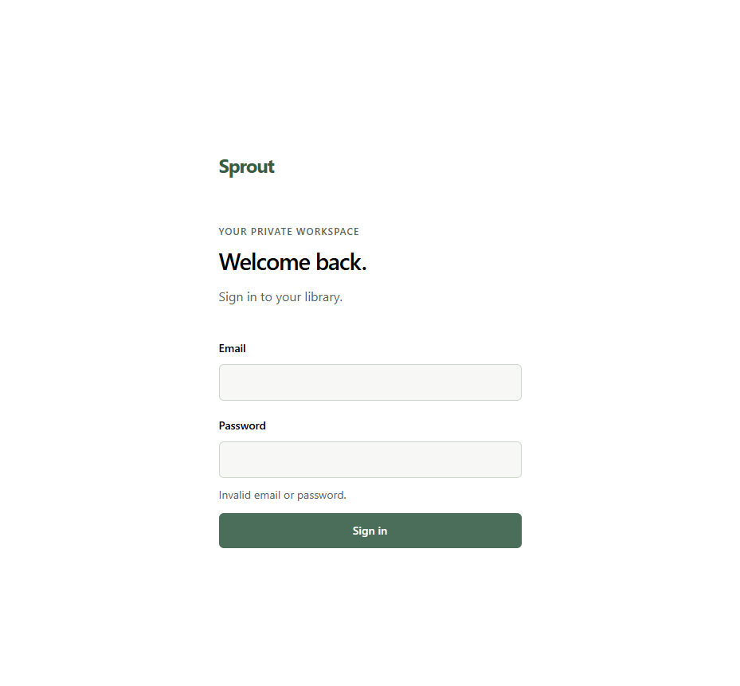
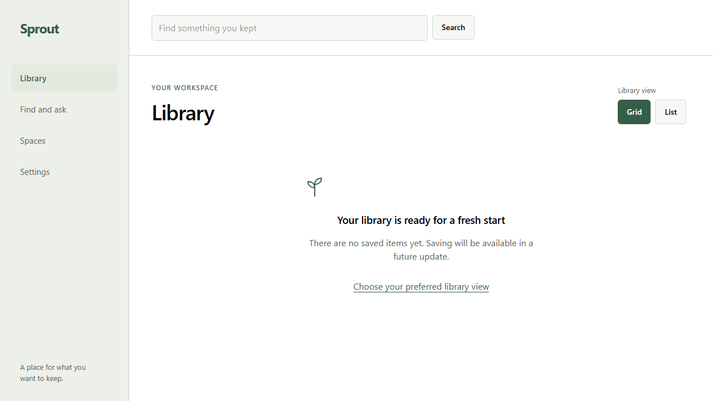
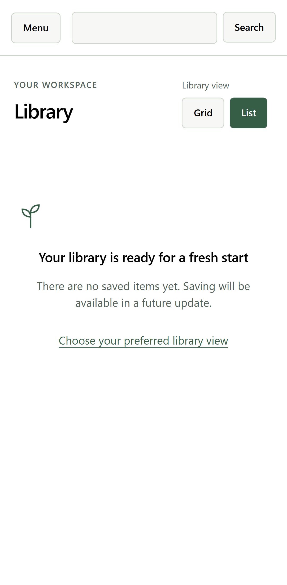

# Issue #3 verification

Runtime evidence for application code at `dc69329f9f32f7b7bb5fa77d1af018aeab8db493`.
All users and data are synthetic. Screenshots contain no credentials or account
details. This record does not authorize deployment or merge.

## Executed checks

```text
corepack pnpm check: exit 0
  format:check and lint: passed
  React Doctor: No issues found!
  typecheck: 11 successful tasks
  unit: 7 files, 129 tests passed
  build: 7 successful tasks
  documentation checks: passed

Local application processes with PostgreSQL:
  test:integration: 22 passed
  test:e2e: 20 passed, desktop and mobile

Full Docker Compose:
  test:integration: 22 passed
  test:e2e: 20 passed, desktop and mobile
```

The local aggregate run used cached typecheck/build results. Hosted CI runs
independently on the PR head; its current status is recorded in the PR body.

Use the isolated workspace and private environment setup in
[Development](../../development.md). The workspace runner executes the real
integration and browser suites with separate database logins:

```powershell
node scripts/auth-workspace.mjs
node scripts/auth-workspace.mjs --compose
```

## Approved proof cases

| Case               | Observable coverage                                                                                                                                                                                   |
| ------------------ | ----------------------------------------------------------------------------------------------------------------------------------------------------------------------------------------------------- |
| Login lifecycle    | Signed cookie attributes, seven-day absolute expiry without sliding, reload/new tab, expired access, durable logout failure and retry, revoked-cookie replay.                                         |
| Signup closure     | Direct and encoded paths, alternate methods, internal create hook, denied runtime SQL inserts, unchanged user/account counts, no registration UI.                                                     |
| Bootstrap          | Interrupted provisioning rolls back; concurrent invocations create one complete owner; rerun and inconsistent-installation behavior.                                                                  |
| Two-user RLS       | Separate persisted preferences; foreign reads/updates, owner reassignment, anonymous/forged credentials, and forged owner settings fail.                                                              |
| Pool lifetime      | Pool size one across commit, rollback, expiry, query cancellation, disconnect and failed cleanup; an abandoned HTTP write cannot persist; late browser responses cannot restore private UI.           |
| Privilege boundary | Actual runtime logins deny escalation and identity creation; worker credentials cannot reconnect as API/auth; elevated or owning web roles prevent API startup.                                       |
| Shell navigation   | Desktop/mobile sign-in and navigation, view preference after reload, deep links, URL search/back, keyboard/reduced motion, drawer focus restoration, return-path rejection, no private-content flash. |
| Availability       | Database connection loss, API failures, retry states and failed logout hide private content without claiming success.                                                                                 |

The integration cases live in [auth.test.ts](../../../tests/integration/auth.test.ts).
Browser cases live in [screen.spec.ts](../../../tests/e2e/screen.spec.ts).

The independent parent browser inspection also observed an anonymous
`/settings` redirect to login, generic invalid-credential feedback, a 401 from
`/api/shell`, no private shell, and no registration links. T3 snapshot automation
timed out twice; this inspection used Playwright instead.

## Screenshots

The desktop and mobile library captures come from the authenticated Playwright
journey. The login capture shows generic feedback after invalid synthetic input.







## Evidence limits

Actual Galaxy touch, Windows shutdown/recovery, and HTTPS tunnel cookie behavior
still require the separate device and ingress evidence identified in the approved
design. The item inspector has no real saved item in this slice; missing-item
navigation is tested, while real-item focus restoration remains future proof.

## Excess-grant follow-up

At code commit `096c111`, fresh `corepack pnpm check` exited 0 on
2026-10-23. Format, lint, React Doctor and documentation checks passed.
Unit tests passed 129/129 across seven files. Eleven typecheck tasks and
seven build tasks passed from cache. Fresh local runtime proof follows below.

