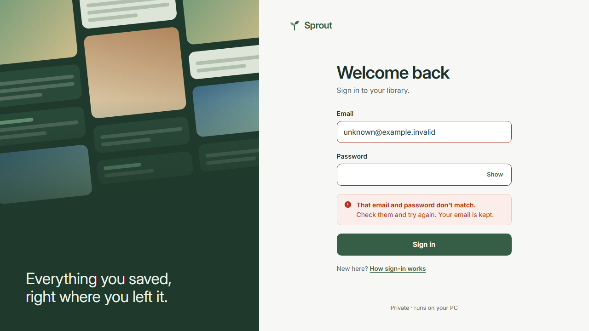

# Issue #3 verification

Fresh local evidence for application and test code at `b1bc7da` on 2026-10-24.
All users and data are synthetic. Screenshots contain no credentials or account
details. This record does not authorize deployment or merge.

## Executed checks

```text
corepack pnpm check: exit 0
  format:check and lint: passed
  React Doctor: No issues found!
  typecheck: 11 successful tasks
  unit: 7 files, 129 tests passed
  build: 7 successful tasks
  documentation checks: passed

Local application processes with PostgreSQL:
  test:integration: 2 files, 44 tests passed (19.63s)
  test:e2e: desktop 17 passed (27.3s), mobile 17 passed (30.7s)
  workspace runner: exit 0
  test-results/desktop/.last-run.json: status passed, failedTests []
  test-results/mobile/.last-run.json: status passed, failedTests []

Historical full Docker Compose at dc69329:
  test:integration: 22 passed
  test:e2e: 20 passed, desktop and mobile
```

The local aggregate run used cached typecheck/build results. Hosted CI runs
independently on the PR head; its current status is recorded in the PR body.

Use the isolated workspace and private environment setup in
[Development](../../development.md). The workspace runner executes the real
integration and browser suites with separate database logins:

```powershell
node scripts/auth-workspace.mjs
node scripts/auth-workspace.mjs --compose
```

## Approved proof cases

| Case               | Observable coverage                                                                                                                                                                                   |
| ------------------ | ----------------------------------------------------------------------------------------------------------------------------------------------------------------------------------------------------- |
| Login lifecycle    | Signed cookie attributes, seven-day absolute expiry without sliding, reload/new tab, expired access, durable logout failure and retry, revoked-cookie replay.                                         |
| Signup closure     | Direct and encoded paths, alternate methods, internal create hook, denied runtime SQL inserts, unchanged user/account counts, no registration UI.                                                     |
| Bootstrap          | Interrupted provisioning rolls back; concurrent invocations create one complete owner; rerun and inconsistent-installation behavior.                                                                  |
| Two-user RLS       | Separate persisted preferences; foreign reads/updates, owner reassignment, anonymous/forged credentials, and forged owner settings fail.                                                              |
| Pool lifetime      | Pool size one across commit, rollback, expiry, query cancellation, disconnect and failed cleanup; an abandoned HTTP write cannot persist; late browser responses cannot restore private UI.           |
| Privilege boundary | Actual runtime logins deny escalation and identity creation; worker credentials cannot reconnect as API/auth; elevated or owning web roles and excess schema/table/column grants are rejected by startup validation. |
| Shell navigation   | Desktop/mobile sign-in and navigation, view preference after reload, deep links, URL search/back, keyboard/reduced motion, drawer focus restoration, return-path rejection, no private-content flash. |
| Availability       | Database connection loss, API failures, retry states and failed logout hide private content without claiming success.                                                                                 |

The integration cases live in [auth.test.ts](../../../tests/integration/auth.test.ts).
Browser cases live in [screen.spec.ts](../../../tests/e2e/screen.spec.ts).

The independent parent browser inspection also observed an anonymous
`/settings` redirect to login, generic invalid-credential feedback, a 401 from
`/api/shell`, no private shell, and no registration links. T3 snapshot automation
timed out twice; this inspection used Playwright instead.

## Screenshots

The desktop and mobile library captures come from the authenticated Playwright
journey. The login capture shows generic feedback after invalid synthetic input.




## Evidence limits

Actual Galaxy touch, Windows shutdown/recovery, and HTTPS tunnel cookie behavior
still require the separate device and ingress evidence identified in the approved
design. The item inspector has no real saved item in this slice; missing-item
navigation is tested, while real-item focus restoration remains future proof.

## Excess-grant follow-up

Startup validation checks the assumable `sprout_web` role directly, including
column-only grants. The 22 new negative cases failed on checkpoint `83b6f95`
before the guard landed. All 44 integration tests now pass, including those
cases and confirmation that the approved permissions remain accepted.

The first local follow-up exposed PostgreSQL revoking approved column UPDATE
grants when the table UPDATE test was cleaned up. The fixture now restores
`UPDATE (library_view, updated_at)` after that case. The full check, integration,
then e2e were repeated serially after this fix. The fresh passing e2e artifact
replaces the earlier failed run. Desktop and mobile captures were refreshed
from this passing journey and inspected for synthetic-only content.

Blast-radius proof covers the shared validator used by API, auth and worker
startup. The fresh workspace starts with the approved grants; real database
grants are then rejected and restored by the negative cases. The API startup
failure test also confirms an unsafe web role exits before listening. No
migration grants, RLS policies, CI jobs or enforcement requirements changed in
this follow-up.


## Browser project isolation follow-up (2026-10-24)

At `b1bc7da`, lint and typecheck passed. Fresh local integration passed
44/44 tests across two files in 19.63 seconds. The runner now restarts the
API before each browser project, preserving production rate limits, and runs
Compose down for its selected project during cleanup. Browser proof follows.

Fresh local e2e passed all 34 cases: desktop 17 passed (27.3s), mobile
17 passed (30.7s), including both formerly failing mobile cases. Both project
last-run records report passed with no failed tests. The runner exited 0 and
Compose removed its PostgreSQL container and project network; volumes remain.

The approved Greenhouse direction uses Inter from the supplied review sheet,
abstract shapes only, and the existing sage palette. The fresh captures below
come from the passing run at `b1bc7da`; all inputs and content are synthetic.

| Approved state | Fresh capture |
| --- | --- |
| Desktop sign-in | [Default](greenhouse-desktop-default.png) |
| Desktop wrong password, email retained | [Mismatch alert](greenhouse-desktop-wrong-password.png) |
| Mobile signing in | [Pending](greenhouse-mobile-pending.png) |
| Mobile 503 and retry | [Unavailable](greenhouse-mobile-unavailable.png) |
| Mobile local owner help | [New here](greenhouse-mobile-help.png) |
| Mobile dark mode | [Dark](greenhouse-mobile-dark.png) |
| Successful sign-in | [Authenticated library](greenhouse-desktop-authenticated.png) |
| Mobile shell navigation | [Navigation drawer](greenhouse-mobile-navigation.png) |

The former failures shared the API's in-memory sign-in budget across browser
projects. The runner now starts each project with a fresh API process; it does
not alter limits, mock successful sign-in, or add a reset endpoint. Both projects
retain their original tests and independent passing `.last-run.json` artifacts.

The fresh full `corepack pnpm check` exited 0 after the runtime run, including
129 unit tests in seven files, clean lint/format/React Doctor, 11 cached
typechecks, seven cached builds, and passing documentation checks.

